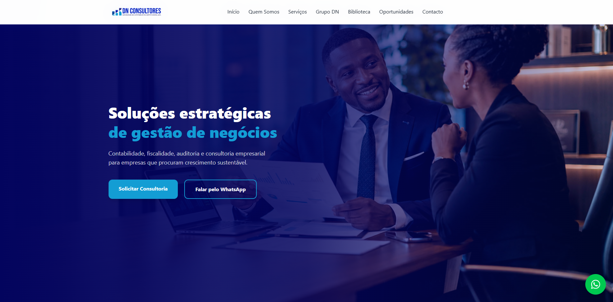

# DN Consultores — Website Institucional

**Caso de estudo de desenvolvimento web · Projecto para cliente**  
**Autor / desenvolvimento:** Alane Savanguane  
**Site:** [www.dnconsultores.co.mz](https://www.dnconsultores.co.mz)  
**Repositório:** apresentação pública sem o código-fonte da aplicação



## Visão geral

Website institucional desenvolvido para a **DN Consultores**, empresa de serviços de contabilidade, fiscalidade, auditoria e consultoria empresarial em Moçambique. O projecto organiza os serviços da empresa, a apresentação institucional, as oportunidades e os canais de contacto numa experiência web adaptável a dispositivos móveis.

> **Evidência:** as funcionalidades e tecnologias abaixo foram identificadas nos ficheiros do projecto disponibilizados pelo autor. O domínio constitui a referência pública do trabalho. No momento de preparação deste showcase, não foi possível capturar nem validar visualmente a versão em produção; por isso, as imagens aqui incluídas são **recursos do projecto**, não screenshots do site activo.

## Tecnologias utilizadas

- **Next.js**, **React** e **TypeScript**
- **Tailwind CSS** para estilos responsivos
- **Framer Motion** para animações
- **Nodemailer** para processamento de mensagens do formulário de contacto e subscrição
- Metadados SEO, sitemap e robots gerados no Next.js

## Funcionalidades identificadas no projecto

| Área | Implementação identificada |
| --- | --- |
| Página inicial | Hero, apresentação de serviços, projectos, parceiros, CTA, contacto e newsletter |
| Páginas institucionais | Sobre, Serviços, Grupo DN e Biblioteca |
| Oportunidades | Listagem e páginas individuais por `slug` |
| Formulários | Rotas de API para contacto e newsletter |
| Navegação e acessibilidade | Componentes de navegação, layouts responsivos e consentimento de cookies |
| SEO | `metadata`, `sitemap.ts` e `robots.ts` |

**Âmbito da contribuição:** desenvolvimento web do projecto fornecido. O nível de participação de terceiros, a autoria individual de cada componente e os resultados de negócio não estão documentados neste showcase.

## Recursos visuais presentes no código

### Imagem principal


### Secções institucionais


As imagens acima foram extraídas da pasta `public/images` do projecto. **Não são capturas da interface em produção.** A sua publicação deve respeitar a autorização da DN Consultores e os direitos dos respectivos titulares.

## Arquitectura resumida

```text
Navegador
    |
    v
Next.js / React (App Router)
    |-- Páginas institucionais e componentes reutilizáveis
    |-- Formulários (contacto / newsletter)
    |-- Rotas API (servidor)
            |-- Nodemailer --> servidor SMTP configurado por variáveis de ambiente
```

Para decisões técnicas, consulte [docs/arquitectura.md](docs/arquitectura.md).

## Demonstração

1. Visite o [site institucional](https://www.dnconsultores.co.mz).
2. Navegue pelas páginas de serviços, sobre a empresa e oportunidades.
3. Consulte os recursos visuais nesta apresentação.
4. As capturas verificadas da versão em produção serão adicionadas na pasta [`screenshots/`](screenshots/README.md) após recolha e revisão.

> Não são divulgados código-fonte privado, credenciais SMTP, dados de formulários nem informações de clientes.

## Contacto profissional

**Alane Savanguane** — Full-Stack Developer  
Maputo, Moçambique  
GitHub: [@AlaneDeJesus258](https://github.com/AlaneDeJesus258)  
Email: [savanguanealane757@gmail.com](mailto:savanguanealane757@gmail.com)

---
*Este repositório é um case study para portefólio. Não é o repositório oficial de código-fonte da DN Consultores.*
